  <a href="mailto:gandhamjayanth27@gmail.com">Email</a> &nbsp;·&nbsp;
  <a href="https://www.linkedin.com/in/g-v-s-jayanth-4a7a8b195/">LinkedIn</a> &nbsp;·&nbsp;
  Oracle Cloud Infrastructure Certified Architect

| Project | What it is |
| --- | --- |
| [facechain-verify](https://github.com/Jayanth19524/facechain-verify) | Face verification pipeline using InsightFace, with on-chain attestations |
| [ats-npm-1](https://github.com/Jayanth19524/ats-npm-1) | Resume parsing and candidate ranking |
| [Placements-portal](https://github.com/Jayanth19524/Placements-portal) | Placements portal built for Mahindra University |
| [binary-tree-visualizer-](https://github.com/Jayanth19524/binary-tree-visualizer-) | Interactive binary tree visualizer in TypeScript |
| [distributed-systems-assignment4](https://github.com/Jayanth19524/distributed-systems-assignment4) | Lamport and vector clocks over MPI and sockets |

**Backend** Java, Spring Boot, Node.js, Python, C++, C#/.NET, Django  
**Frontend** TypeScript, React, Angular  
**Data** PostgreSQL, MySQL, MongoDB  
**Infra** Docker, Kubernetes, AWS, Azure, GCP, OCI
