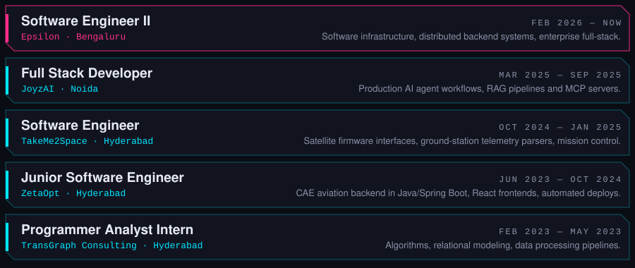

  <a href="mailto:gandhamjayanth27@gmail.com">Email</a> ·
  <a href="https://www.linkedin.com/in/g-v-s-jayanth-4a7a8b195/">LinkedIn</a> ·
  Oracle Cloud Infrastructure Certified Architect

- **[facechain-verify](https://github.com/Jayanth19524/facechain-verify)**: face verification pipeline using InsightFace, with on-chain attestations.
- **[ats-npm-1](https://github.com/Jayanth19524/ats-npm-1)**: resume parsing and candidate ranking.
- **[Placements-portal](https://github.com/Jayanth19524/Placements-portal)**: placements portal built for Mahindra University.
- **[binary-tree-visualizer-](https://github.com/Jayanth19524/binary-tree-visualizer-)**: interactive binary tree visualizer in TypeScript.
- **[distributed-systems-assignment4](https://github.com/Jayanth19524/distributed-systems-assignment4)**: Lamport and vector clocks over MPI and sockets.

**Backend:** Java, Spring Boot, Node.js, Python, C++, C#/.NET, Django  
**Frontend:** TypeScript, React, Angular  
**Data:** PostgreSQL, MySQL, MongoDB  
**Infra:** Docker, Kubernetes, AWS, Azure, GCP, OCI
