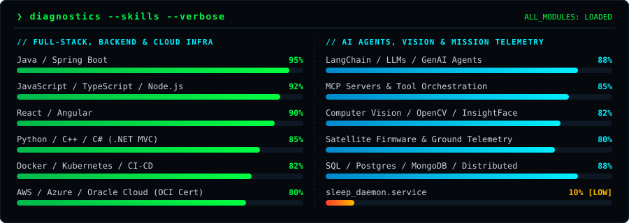
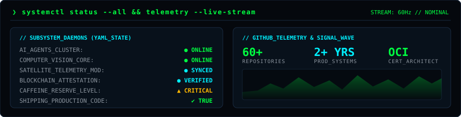
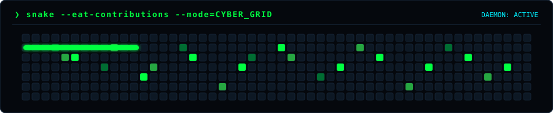

<div align="center">

<!-- CYBERPUNK TERMINAL HERO HUD -->


<br/>

<!-- ANIMATED TERMINAL TYPING STREAM -->
<a href="https://github.com/Jayanth19524">
  
</a>

<!-- QUICK CONNECT & CLEARANCE BADGES -->
<p align="center">
  <a href="mailto:gandhamjayanth27@gmail.com">
    
  </a>
  <a href="https://www.linkedin.com/in/g-v-s-jayanth-4a7a8b195/">
    
  </a>
  <a href="https://github.com/Jayanth19524">
    
  </a>
  
</p>


</div>

## ⚡ `$ git log --career-trajectory`

<div align="center">
  
</div>

<div align="center">
  
</div>

## 🛰️ `$ htop --projects`

<div align="center">
  
</div>

<details>
<summary><b><code>❯ tree ./projects --architecture-breakdown</code></b> <i>(Click to expand full system tree)</i></summary>
<br/>

```text
projects/
├── FaceChain Verify                 [AI Biometrics • Computer Vision • Blockchain]
│   ├── InsightFace                  → High-precision facial embedding extraction
│   ├── Reverse Image Discovery      → Multi-source identity & media discovery
│   ├── Evidence Collection          → Automated cryptographic proof bundling
│   ├── Verification Engine          → Real-time confidence scoring pipeline
│   └── Blockchain Attestations      → Tamper-proof on-chain verification records
│
├── MCP Agent Platform               [Generative AI • Model Context Protocol • Infra]
│   ├── Tool Integrations            → Standardized MCP server connectors
│   ├── Agent Orchestration          → Multi-agent task routing & state management
│   ├── Event Pipelines              → Low-latency streaming execution loops
│   └── Workflow Automation          → Autonomous enterprise process execution
│
├── Satellite Ground Station Parser  [Space-Tech • Embedded Telemetry • Mission Ops]
│   ├── Telemetry Processing         → High-throughput binary packet decoding
│   ├── Data Extraction              → Sensor health & orbital state reconstruction
│   └── Mission Operations           → Real-time ground station monitoring
│
├── ATS Resume Engine                [NLP • Vector Search • Ranking]
│   ├── NLP Parsing                  → Structured entity extraction from resumes
│   ├── Semantic Search              → Embedding-driven role & skill matching
│   └── Candidate Ranking            → Automated scoring & shortlist generation
│
└── Placements Portal                [Full-Stack • Enterprise Workflows]
    ├── Django Backend               → Scalable REST APIs & role-based auth
    └── Database Models & Views      → Relational data modeling & analytics views
```

</details>

<div align="center">
  
</div>

## 🧠 `$ diagnostics --skills --verbose`

<div align="center">
  
  <br/><br/>
  
</div>

<div align="center">
  
</div>

## 📡 `$ systemctl status && telemetry --live`

<div align="center">
  
  <br/><br/>
  
  <br/><br/>
  
</div>

<div align="center">
  
</div>

<div align="center">

```bash
$ echo "Turning complex ideas into simple, scalable systems." && exit 0
# SESSION_STATUS: ACTIVE // READY_FOR_COLLABORATION
```

<a href="mailto:gandhamjayanth27@gmail.com">
  
</a>
<a href="https://www.linkedin.com/in/g-v-s-jayanth-4a7a8b195/">
  
</a>
<a href="https://github.com/Jayanth19524">
  
</a>

</div>
